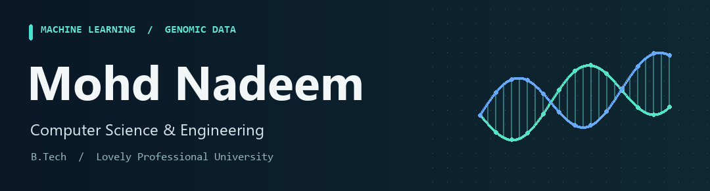

  
  
  

# Hi, I’m Mohd Nadeem

I study Computer Science and Engineering at **Lovely Professional University**, with a focus on AI and machine learning. I build dashboards that let people inspect the data behind a prediction. In GeneVISTA, for example, you can compare a model’s estimate with the classification recorded in ClinVar.

## Featured projects

| Project | What you can explore |
| --- | --- |
| [**GeneVISTA**](https://github.com/MohdNadeem8755/GeneVISTA-AI-Powered-Genomic-Variant-Interpretation-Disease-Prediction-Platform) | Trace a genetic variant’s classification history and explore how ClinGen evidence and model estimates relate to the record. |
| [**Transport Demand Prediction**](https://github.com/MohdNadeem8755/Data-_Science-_Capstone_Project-_-Transport-Demand-Prediction-) | Forecast passenger seat requirements from historical bookings and compare demand across routes, months and weekends. |
| [**ResistMap AI**](https://github.com/MohdNadeem8755/Resistmap_AI) | Explore antimicrobial resistance surveillance through a Hindi and English research dashboard. Independent model validation is in progress. |
| [**Smart Indoor Air Quality**](https://github.com/MohdNadeem8755/AI_Smart_Indoor_Air_Quality_PCA_LDA_RF_PSO) | Explore how temperature, humidity, gas readings and occupancy feed into an air-quality classifier in Streamlit. |

## Tech stack

I use **pandas** and **NumPy** to prepare data, **scikit-learn** to evaluate models, and **Streamlit** and **Matplotlib** to share the results.

## Experience and learning

- **Data science and machine learning internship · Launched Global** — I used Python to forecast passenger demand, from cleaning historical records to tuning and evaluating regression models.
- **Data structures and algorithms · LPU** — During 50 hours of training, I built a conflict-resolution engine using graph algorithms and priority queues.

[Oracle Cloud AI Foundations Associate](https://www.linkedin.com/posts/mohd-nadeem-_proud-oracle-cloud-ai-foundations-associate-activity-7502276935528648704-mRyu) · [Generative AI with Snowflake](https://www.linkedin.com/posts/mohd-nadeem-_completed-generative-ai-with-snowflake-certificate-activity-7502450938536857600-1suI)

## GitHub activity

[Explore all repositories](https://github.com/MohdNadeem8755?tab=repositories) · [Get in touch on LinkedIn](https://www.linkedin.com/in/mohd-nadeem-/)
