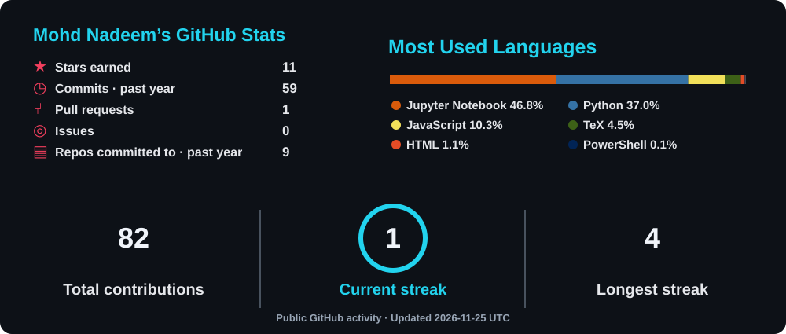

# Mohd Nadeem

### AI & ML Undergraduate | Data Science | Python Developer

---

## `whoami` — About Me

- 🎓 I study **Computer Science and Engineering (AI & ML)** at Lovely Professional University, Phagwara.
- 🧬 I’m building **GeneVISTA** so researchers can trace a variant’s classification history and examine the evidence behind it.
- 📊 During my internship at **Launched Global**, I worked with historical transport data to forecast passenger seat demand.
- 🛠️ I use **Python, scikit-learn, FastAPI and React** to take a model from a notebook to an interactive dashboard.
- 🧩 I practise graph algorithms and data structures in C++. [LeetCode profile](https://leetcode.com/u/mohd_nadeem8755/)

## Tech Stack

### Languages

### Data, ML & Tools

**Also familiar with** pandas, NumPy, Matplotlib, Seaborn, Power BI, Streamlit, SQLite, Docker and Jupyter Notebook.

## Featured Projects

### GeneVISTA

Trace a genetic variant’s classification history and explore how ClinGen evidence and model estimates relate to the record.

[Open the GeneVISTA repository](https://github.com/MohdNadeem8755/GeneVISTA-AI-Powered-Genomic-Variant-Interpretation-Disease-Prediction-Platform)

### Transport Demand Prediction

Forecast passenger seat requirements from historical bookings and compare demand across routes, months and weekends.

[Open the Transport Demand Prediction repository](https://github.com/MohdNadeem8755/Data-_Science-_Capstone_Project-_-Transport-Demand-Prediction-)

### ResistMap AI

Explore antimicrobial resistance surveillance through a Hindi and English research dashboard. Independent model validation is in progress.

[Open the ResistMap AI repository](https://github.com/MohdNadeem8755/Resistmap_AI)

### Smart Indoor Air Quality

Explore how temperature, humidity, gas readings and occupancy feed into an air-quality classifier in Streamlit.

[Open the Smart Indoor Air Quality repository](https://github.com/MohdNadeem8755/AI_Smart_Indoor_Air_Quality_PCA_LDA_RF_PSO)

## Experience & Learning

- **Data Science Intern · Launched Global** (Jun–Jul 2025). I cleaned historical transport records, engineered route and calendar features, and compared regression models for seat-demand forecasting.
- **Code Quest DSA Bootcamp · Lovely Professional University** (Jun–Jul 2026). I used graph traversal and priority queues to build a multi-agent conflict-resolution engine.

## Certifications

- [Oracle Cloud Infrastructure AI Foundations Associate](https://www.linkedin.com/posts/mohd-nadeem-_proud-oracle-cloud-ai-foundations-associate-activity-7502276935528648704-mRyu) · Oracle
- [Introduction to Generative AI with Snowflake](https://www.linkedin.com/posts/mohd-nadeem-_completed-generative-ai-with-snowflake-certificate-activity-7502450938536857600-1suI)
- [Master Data Structures & Algorithms](https://www.linkedin.com/posts/mohd-nadeem-_data-structures-algorithms-summer-training-activity-7500569479031136258-lV5N) · Lovely Professional University
- [Complete Database & SQL Masterclass](https://www.linkedin.com/posts/mohd-nadeem-_completed-database-sql-masterclass-dbms-activity-7500567472450990080-tNWl) · Udemy

## Research in Progress

**GeneVISTA** explores variant annotations in ClinVar and gene–disease evidence from ClinGen. **ResistMap AI** explores genomic surveillance of antimicrobial resistance. [Research and project portfolio](https://mohdnadeem8755.github.io/)

## GitHub Analytics

## Contribution Snake

## Let’s Connect

### Have an idea for a data science project?

---

## Animated Profile Panels

### What I work on

Python and data analysis · Predictive modelling · DSA and problem solving · Web apps and databases

 
 

### Let’s work together

<table><tr><td align="center"></td><td>
 
 

</td></tr></table>

## Connect with Me

## Featured Repositories

| Project | What to explore | Repository |
| --- | --- | --- |
| **GeneVISTA** | Trace a genetic variant’s classification history and explore how ClinGen evidence and model estimates relate to the record. | [Open repository](https://github.com/MohdNadeem8755/GeneVISTA-AI-Powered-Genomic-Variant-Interpretation-Disease-Prediction-Platform) |
| **Transport Demand Prediction** | Forecast passenger seat requirements from historical bookings and compare demand across routes, months and weekends. | [Open repository](https://github.com/MohdNadeem8755/Data-_Science-_Capstone_Project-_-Transport-Demand-Prediction-) |
| **ResistMap AI** | Explore antimicrobial resistance surveillance through a Hindi and English research dashboard. Independent model validation is in progress. | [Open repository](https://github.com/MohdNadeem8755/Resistmap_AI) |
| **Smart Indoor Air Quality** | Explore how temperature, humidity, gas readings and occupancy feed into an air-quality classifier in Streamlit. | [Open repository](https://github.com/MohdNadeem8755/AI_Smart_Indoor_Air_Quality_PCA_LDA_RF_PSO) |

## About

**B.Tech CSE (AI & ML)** · Lovely Professional University · 2024–present  
**Internship** · Data Science · Launched Global · 2025  
**Training** · Code Quest DSA Bootcamp · LPU · 2026

[Visit my portfolio](https://mohdnadeem8755.github.io/) · [Browse all repositories](https://github.com/MohdNadeem8755?tab=repositories)
